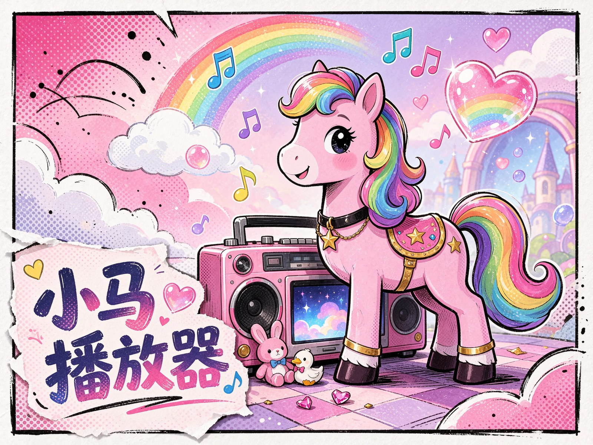

<p align="center"></p>

<h1 align="center">小马宝莉 SWF 播放器</h1>

<p align="center">粉色主题的桌面 SWF 播放器，双模式兼容，专治「Flash 打不开」</p>

## 简介

给小马宝莉同好做的本地播放器：选一个 SWF 文件，能直接用系统关联程序打开就用系统程序；打不开就自动生成一个内嵌 Ruffle 模拟器的 HTML，在浏览器里播。界面走粉色渐变 + Comic Sans，配一个程序化画出来的彩虹鬃毛图标。

## 功能

- **双模式播放**：系统默认程序优先，失败自动降级到浏览器 + Ruffle
- **一键选文件**：本地浏览 SWF，路径自动记录
- **状态反馈**：当前在做什么、结果如何，界面上实时显示
- **日志记录**：播放过程写日志，出问题好排查
- **程序化图标**：Pillow 生成多尺寸 ICO，不依赖外部素材
- **可打包**：PyInstaller 打成免安装 exe

## 技术栈

Python 3.6+ · Tkinter ｜ Ruffle（CDN 加载，WebAssembly）｜ Pillow（图标）｜ PyInstaller（打包）

## 快速开始

```bash
git clone https://github.com/aiyangdie/yourusername-pony-swf-player.git
cd yourusername-pony-swf-player
pip install -r requirements.txt
python swf_player_gui.py
```

打包为 exe：

```bash
pyinstaller --onedir --windowed --icon=pony_icon.ico swf_player_gui.py   # 目录模式，约 1.7 MB
pyinstaller --onefile --windowed --icon=pony_icon.ico swf_player_gui.py  # 单文件，约 10 MB
```

重新生成图标：`python create_icon.py`。

## 项目结构

```
swf_player_gui.py   主程序（GUI + 播放逻辑）
create_icon.py      图标生成
pony_icon.ico       程序图标
requirements.txt
```

## 说明

Ruffle 模式需要联网加载 CDN 资源；系统程序模式依赖本机已关联 SWF 的播放器。

## 许可证

仓库未附 LICENSE 文件，作者原有声明为 MIT，分发或商用前请确认。
